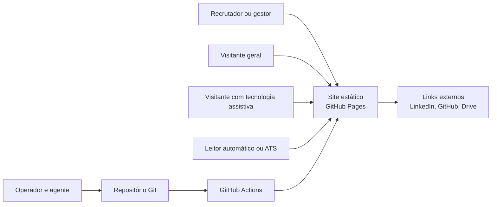
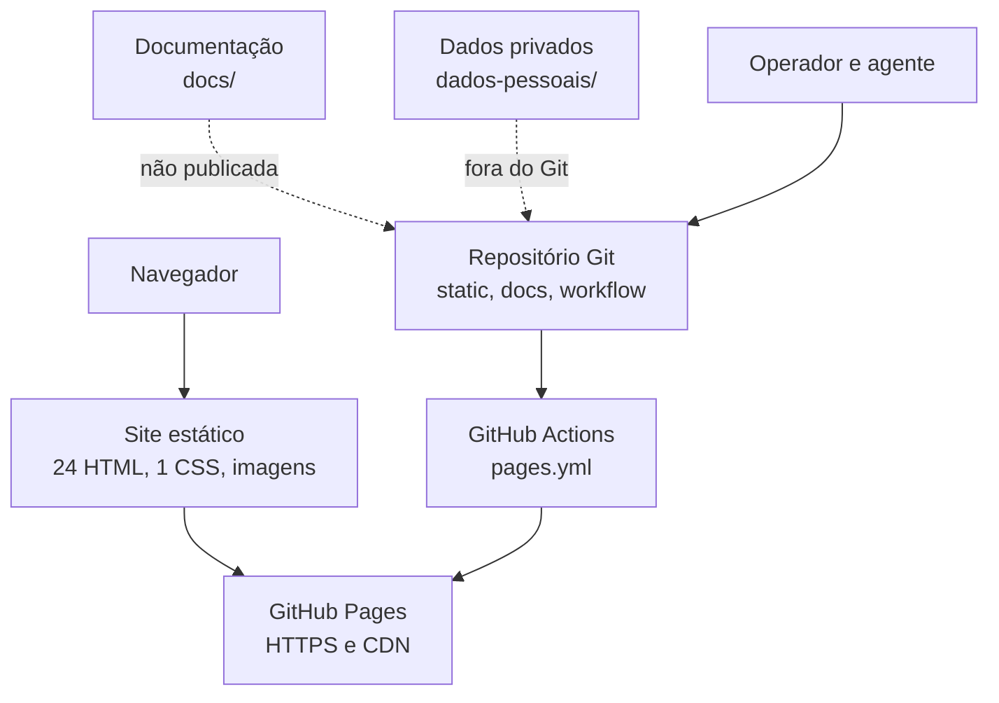
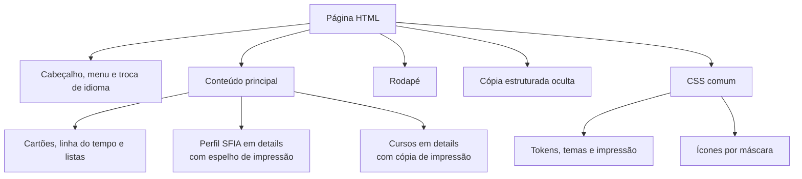
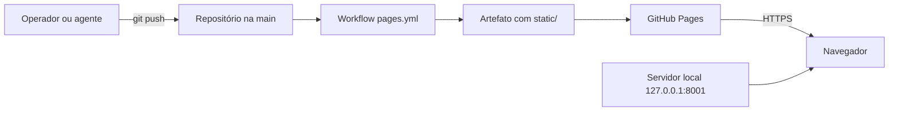
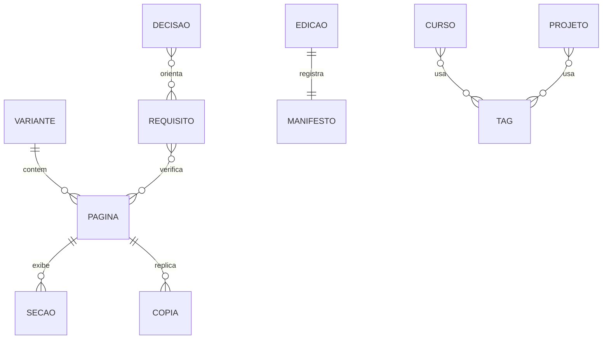

# Arquitetura do portfólio

> DOC-ARQ-01 · versão 1.0 · situação: revisão · base: 445ea45 · revisão: 2026-11-05 · responsável: operador

## 1. Objetivo e escopo

Este documento descreve a arquitetura do site estático e da publicação.
A estrutura adapta arc42 e C4, sem conformidade com essas referências. Os diagramas usam Mermaid.

**Dentro:** HTML, CSS, imagens, ícones, workflow de publicação e documentação.
**Fora:** navegador, GitHub Pages, DNS, TLS, Google Drive, LinkedIn e sites vinculados.

## 2. Partes interessadas e qualidade

| Parte | Interesse |
| --- | --- |
| Recrutador ou gestor | Lê o currículo, os projetos e o contato. |
| Visitante com tecnologia assistiva | Navega por teclado e leitor de tela. |
| Visitante geral | Lê, imprime e usa a troca de idioma. |
| Operador | Aprova escopo, conteúdo e publicação. |
| Agente | Analisa, altera, verifica e registra. |
| GitHub | Hospeda o repositório e publica o site. |

| Requisito | Cenário de qualidade | Verificação | Situação |
| --- | --- | --- | --- |
| NFR-01 | Leitura por teclado, foco visível, contraste e zoom. | Ensaio manual por página. | Parcial. |
| NFR-02 | Nenhum script, formulário ou iframe. | Inspeção do HTML. | Vigente. |
| NFR-03 | Nenhum recurso externo de fonte, imagem ou script. | Inspeção de `src` e `href`. | Vigente. |
| NFR-05 | Conteúdo legível a 320 CSS px. | Ensaio em largura reduzida. | Vigente. |
| NFR-06 | Temas claro e escuro, impressão e movimento reduzido. | Ensaio nas quatro condições. | Vigente. |
| NFR-07 | HTML semântico e um `h1` por página. | Validação pendente. | Parcial. |
| NFR-08 | Publicação com permissões mínimas e ações fixadas. | Conferência do workflow. | Parcial. |

## 3. Visão de contexto

O visitante não se autentica. O operador e o agente trabalham no repositório.
O leitor automático consome a cópia estruturada oculta.

## 4. Visão de contêineres

O workflow copia somente `static/`. Documentação e dados privados não são publicados.

## 5. Visão de componentes

A cópia oculta fica no início do documento. Os espelhos de impressão duplicam o conteúdo visível.
O CSS único tem 858 linhas, tokens em `:root`, tema escuro e regras de impressão.

## 6. Implantação

A página 404 usa caminhos absolutos sob `/portfolio/` para funcionar em URLs aninhadas.
O cache é de 600 segundos. Não há etapa de build.

## 7. Mapa do site

| Variante | `index` | `galeria` | `rede` | `recomendacoes` | `projetos` | Estado |
| --- | --- | --- | --- | --- | --- | --- |
| `pt-BR` | Sim | Sim | Sim | Sim | Sim | Ativa |
| `en` | Sim | Sim | Sim | Sim | — | Ativa, `en-US` |
| `pt-PT` | Sim | Sim | Sim | Sim | — | Redireciona |
| `es-419` | Sim | Sim | Sim | Sim | — | Redireciona |
| `es-ES` | Sim | Sim | Sim | Sim | — | Redireciona |
| Raiz | `index.html` | — | — | — | — | Seleção de idioma |
| Raiz | `404.html` | — | — | — | — | Erro 404 |
| Raiz | `wip.html` | — | — | — | — | Aviso de preparação |

Total: 24 arquivos HTML. `pt-BR` tem 5 páginas; as demais variantes têm 4.
As variantes suspensas usam `meta refresh` para `../wip.html`.

## 8. Modelo de conteúdo

| Entidade | Papel | Onde aparece |
| --- | --- | --- |
| Variante | Versão linguística do site. | Pasta em `static/` e `hreflang`. |
| Página | Arquivo HTML de uma variante. | `static/<variante>/*.html`. |
| Seção | Bloco visível, oculto ou de impressão. | `main`, `#dados-curriculo`, `.sfia-print`. |
| Cópia | Réplica estruturada dos dados. | `#dados-curriculo`, `#dados-projetos`. |
| Requisito | FR ou NFR com critério de aceite. | `docs/requisitos.md`. |
| Decisão | ADR que orienta a estrutura. | `docs/decisoes.md`. |
| Tag | Competência, tecnologia ou qualificação. | Listas visíveis e `docs/listas-de-tags/`. |
| Curso | Formação complementar com data e carga. | `index.html` e `conteudo-e-fontes.md`. |
| Projeto | Trabalho com descrição e links. | `projetos.html`. |
| Edição | PDF e DOCX de currículo. | `docs/curriculos/`. |
| Manifesto | Tamanho, hash e páginas da edição. | `manifesto.json`. |

## 9. Restrições e decisões

| ID | Decisão | Efeito na arquitetura |
| --- | --- | --- |
| 0001 | Site estático sem JavaScript. | Sem interação, formulário ou analytics. |
| 0002 | CSS único compartilhado. | Uma alteração afeta todas as variantes. |
| 0003 | Cinco variantes com base em `pt-BR`. | Sincronização manual de fatos. |
| 0004 | Cópia estruturada oculta. | Dados no mesmo documento. |
| 0005 | Ícones por máscara CSS. | Dependência de suporte a `mask`. |
| 0006 | Projetos apenas em `pt-BR`. | Navegação difere entre variantes. |
| 0007 | Publicação restrita a `static/`. | Docs e dados privados ficam fora. |
| 0008 | Publicação temporária de duas variantes. | Três variantes redirecionam. |

## 10. Lacunas e premissas

- Não há CI de validação; a verificação é manual (`P-15`).
- O método de validação de HTML e títulos não está definido (`P-11`).
- Não houve ensaio com leitor de tela (`P-10`).
- O 2FA e a proteção da `main` estão pendentes (`P-07`).
- A base técnica v2.0 está catalogada, mas o conteúdo foi arquivado fora deste checkout.
- O PDF V4 e o manifesto não incorporam as mudanças dos rascunhos DOCX.
- A documentação não é publicada; o site publica somente `static/`.

## 11. Rastreabilidade das afirmações

| Afirmação | Fonte |
| --- | --- |
| 24 páginas, 5 variantes e 2 ativas | `docs/requisitos.md#6-requisitos-funcionais`; contagem em `static/` |
| Cópia estruturada oculta | `static/pt-BR/index.html:17` |
| Cabeçalho, menu e troca de idioma | `static/pt-BR/index.html:827` e `:839` |
| Botão de download desativado | `static/pt-BR/index.html:855`; `docs/requisitos.md#6-requisitos-funcionais` |
| Perfil SFIA em `details` e espelho | `static/pt-BR/index.html:1101` e `:1149` |
| Cursos em `details` e cópia de impressão | `static/pt-BR/index.html:1282` e `:1392` |
| Tokens, tema escuro, ícones e impressão | `static/assets/css/styles.css:6`, `:22`, `:146` e `:711` |
| Workflow copia `static/` e usa permissões mínimas | `.github/workflows/pages.yml:8` e `:33` |
| Página 404 com caminhos absolutos | `static/404.html:9` e `:10` |
| Cache de 600 segundos e publicação sem build | `docs/manutencao.md#serviço` e `docs/manutencao.md#publicação` |
| Variantes suspensas usam `meta refresh` | `static/es-419/index.html:8` |
| 8 decisões registradas | `docs/decisoes.md#decisões-de-arquitetura` |
| Edição V4 e manifesto | `docs/curriculos/v4/README.md`; `docs/curriculos/v4/manifesto.json` |

## 12. Referências

- `AGENTS.md`: regras do projeto.
- `docs/requisitos.md`: requisitos e pendências.
- `docs/decisoes.md`: decisões de arquitetura.
- `docs/manutencao.md`: operação e publicação.
- `docs/historico/padroes-tecnicos.md`: medições de 02/11/2026.
- Estrutura adaptada de arc42 (`REF-0078`) e C4 (`REF-0070`), sem cópia e sem conformidade.
