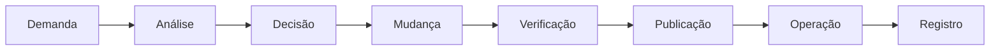
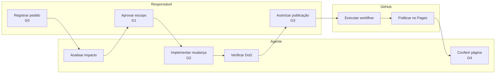
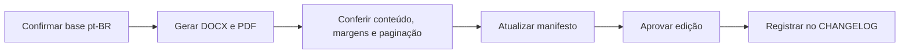
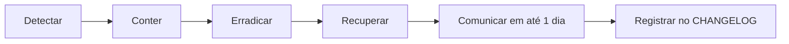

# Processos do projeto

> DOC-PRC-01 · versão 1.0 · situação: revisão · base: 445ea45 · revisão: 2026-11-05 · responsável: operador

## 1. Objetivo e escopo

Este documento descreve os processos de mudança, publicação, edição de currículo e incidente.
Os diagramas usam Mermaid e uma notação adaptada de BPMN, sem conformidade com BPMN 2.0.
As regras vêm de `manutencao.md`, `requisitos.md` e `decisoes.md`. Nenhum processo novo é criado.

## 2. Papéis

| Papel | Responsabilidade |
| --- | --- |
| Responsável | Aprova escopo, conteúdo, publicação e decisões. |
| Agente | Analisa, implementa, verifica e registra. |
| GitHub | Executa o workflow e hospeda o site. |

| Processo | Dono | Executa | Aprova | Registro |
| --- | --- | --- | --- | --- |
| PRC-01 Mudança e publicação | Responsável | Agente | Responsável | `CHANGELOG`, requisitos §11 |
| PRC-02 Edição de currículo | Responsável | Agente e responsável | Responsável | Manifesto, `CHANGELOG` |
| PRC-03 Incidente | Responsável | Responsável e agente | Responsável | `CHANGELOG` |

## 3. Cadeia de valor

## 4. PRC-01 Mudança e publicação

Passos: descrever pedido e fonte; analisar impacto; obter autorização; fazer mudança pequena;
verificar HTML, links, temas e área afetada; usar mensagem de commit clara; registrar no
`CHANGELOG` e nos requisitos; conferir a página publicada.

## 5. PRC-02 Edição de currículo

A edição é identificada. Não é exportação automática de cada mudança do site.
O manifesto registra bytes, SHA-256 e páginas do PDF.
Os rascunhos DOCX ainda não estão no PDF nem no manifesto.

## 6. PRC-03 Incidente

Contenção: reverter o commit, despublicar o site, encerrar sessões e revogar tokens.
Recuperação: publicar a partir de um commit conhecido e conferir as páginas.

## 7. Portas

| Porta | Critério | Evidência | Dono |
| --- | --- | --- | --- |
| G0 | Pedido registrado com ID e finalidade. | Requisito, pendência ou defeito. | Responsável |
| G1 | Escopo e decisão aprovados. | Requisito ou ADR. | Responsável |
| G2 | Mudança verificada. | DoD e `git diff --check`. | Agente |
| G3 | Publicação autorizada. | Checklist e `CHANGELOG`. | Responsável |
| G4 | Publicação conferida. | Raiz, HTTPS, 404 e troca de idioma. | Agente |

## 8. Decisões

**Publicar?**

| Regra | Requisito ou decisão | Fonte do conteúdo | Variantes | Links | DoD | Registro | Resultado |
| --- | --- | --- | --- | --- | --- | --- | --- |
| R1 | Sim | Sim | Sim | Sim | Sim | Sim | Publicar |
| R2 | Não | — | — | — | — | — | Reter e obter decisão |
| R3 | Sim | Sim | Sim | Sim | Sim | Não | Reter até registrar |

**Ativar variante?**

| Regra | Base `pt-BR` concluída | Tradução revisada | `hreflang` recíproco | Links | Acessibilidade | Resultado |
| --- | --- | --- | --- | --- | --- | --- |
| R1 | Sim | Sim | Sim | Sim | Sim | Ativar |
| R2 | Não | — | — | — | — | Manter em `wip.html` |
| R3 | Sim | Não | — | — | — | Manter em `wip.html` |

## 9. Registros

| Registro | Onde fica | Quando é atualizado |
| --- | --- | --- |
| Histórico de mudanças | `CHANGELOG.md` | A cada mudança publicada. |
| Situação e pendências | `docs/requisitos.md` §11 | A cada mudança e revisão. |
| Decisão estrutural | `docs/decisoes.md` | Quando a estrutura muda. |
| Evidência de verificação | Commit e relatório da sessão | Antes da publicação. |
| Edição de currículo | `docs/curriculos/v4/manifesto.json` | A cada edição. |
| Incidente | `CHANGELOG.md` | Ao encerrar o incidente. |

## 10. Lacunas e premissas

- Não há CI; a verificação é manual (`P-15`).
- O 2FA e a proteção da `main` estão pendentes (`P-07`).
- A cópia externa da base arquivada está pendente (`P-08`).
- Zoom, tema escuro, impressão e leitor de tela não foram testados (`P-10`).
- Validação de HTML e navegador atual estão parciais (`P-11`, `P-12`).
- Não há SLA nem monitoramento contínuo; a resposta a incidente é de até um dia.

## 11. Rastreabilidade das afirmações

| Afirmação | Fonte |
| --- | --- |
| Passos de mudança e autorização | `docs/manutencao.md#mudanças` |
| Definition of Done | `docs/manutencao.md#definition-of-done` |
| Publicação e permissões | `docs/manutencao.md#publicação`; `.github/workflows/pages.yml:8` |
| Reversão em até cinco commits | `docs/manutencao.md#mudanças` |
| Incidente e comunicação em um dia | `docs/manutencao.md#incidente` |
| Severidade e prioridade de defeito | `docs/manutencao.md#defeitos` |
| Duas variantes ativas | `docs/requisitos.md#6-requisitos-funcionais`; `docs/decisoes.md#0008--publicação-temporária-de-duas-variantes` |
| 2FA e proteção da `main` | `docs/requisitos.md#7-requisitos-não-funcionais` e `docs/requisitos.md#segurança-e-continuidade` |
| CI pendente | `docs/requisitos.md#verificação-e-qualidade` |
| Sem SLA nem monitoramento contínuo | `docs/manutencao.md#serviço` |
| Página 404 e `CHANGELOG` desde 02/11/2026 | `docs/requisitos.md#10-verificação-e-limites` |
| Edição V4 e manifesto | `docs/curriculos/v4/README.md`; `docs/curriculos/v4/manifesto.json` |
| Última entrada do histórico | `CHANGELOG.md` |

## 12. Referências

- `docs/manutencao.md`: operação, DoD, mudança e incidente.
- `docs/requisitos.md`: requisitos e pendências.
- `docs/decisoes.md`: decisões de arquitetura.
- `.github/workflows/pages.yml`: publicação.
- Notação adaptada de BPMN (`REF-0024`) e decisão (`REF-0013`), sem cópia e sem conformidade.
